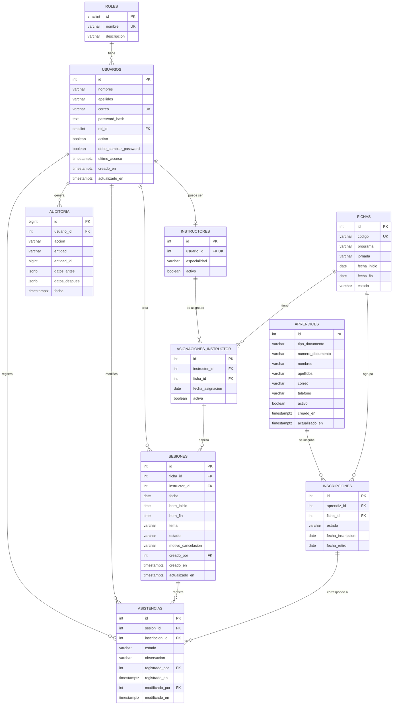

# Modelo entidad-relación de SIGA (versión final de diseño)

Proyecto formativo independiente (ADSO). Datos ficticios únicamente.
Detalle de columnas en `docs/diccionario-datos.md`.

## 1. Diagrama

Además existe la tabla técnica `session`, que usa `connect-pg-simple` para
guardar las sesiones (decisión D2). No tiene relaciones con las demás.

## 2. Descripción de relaciones

| Relación | Cardinalidad | Significado |
|---|---|---|
| roles - usuarios | 1 a N | Cada usuario tiene exactamente un rol. |
| usuarios - instructores | 1 a 0..1 | Un instructor es un usuario con rol Instructor; los datos personales no se duplican. |
| aprendices - inscripciones - fichas | N a M | Un aprendiz puede tener inscripciones en varias fichas; una ficha agrupa muchos aprendices. |
| instructores - asignaciones - fichas | N a M | Un instructor puede atender varias fichas y una ficha puede tener varios instructores. |
| asignaciones - sesiones | 1 a N | Una sesión se apoya en una asignación válida de instructor a ficha (RN-17). Se implementa con una clave foránea compuesta `(instructor_id, ficha_id)`. |
| sesiones - asistencias | 1 a N | Una sesión tiene un registro por aprendiz inscrito. |
| inscripciones - asistencias | 1 a N | La asistencia se liga a la inscripción, no solo al aprendiz, para conservar el contexto de la ficha. |
| usuarios - asistencias | 1 a N (dos veces) | Quién registró y quién modificó. |
| usuarios - auditoria | 1 a N | Quién realizó la operación auditada. |

## 3. Normalización

- **1FN:** todas las columnas guardan valores simples; no hay listas dentro de una celda.
- **2FN y 3FN:** los datos de personas viven una sola vez (`usuarios`,
  `aprendices`). Las relaciones muchos a muchos usan tablas intermedias, y los
  atributos de cada tabla dependen de su propia clave.
- **Desnormalización deliberada:** `fichas.programa` es texto repetido entre
  fichas del mismo programa. Una tabla `programas` queda como mejora futura.
- **Auditoría:** `datos_antes` y `datos_despues` son `jsonb` para guardar el
  cambio sin crear una tabla de historial por entidad. Nunca incluyen contraseñas
  ni hashes.

## 4. Integridad referencial

- Todas las claves foráneas usan `ON DELETE RESTRICT`: como no se borra
  físicamente (D3), un intento de borrado falla en lugar de dejar huérfanos.
- La baja se hace con `activo`, `estado` o `activa`.
- Las claves primarias son enteros de identidad generada por la base de datos.

## 5. Restricciones principales

| Tabla | Restricción | Regla |
|---|---|---|
| usuarios | Índice único sobre `lower(correo)` | Correo único sin distinguir mayúsculas |
| aprendices | `UNIQUE (tipo_documento, numero_documento)` | RN-07 |
| fichas | `UNIQUE (codigo)` y `CHECK (fecha_fin >= fecha_inicio)` | HU-10 |
| inscripciones | `UNIQUE (aprendiz_id, ficha_id)` | RN-08 |
| asignaciones_instructor | `UNIQUE (instructor_id, ficha_id)` | RN-09 |
| sesiones | `CHECK (hora_fin > hora_inicio)` | RN-10 |
| sesiones | Clave foránea compuesta `(instructor_id, ficha_id)` hacia asignaciones | RN-17 |
| sesiones | Exclusión por instructor y por ficha con rango de tiempo, para sesiones no canceladas | RN-11 (a verificar en la Etapa 4) |
| asistencias | `UNIQUE (sesion_id, inscripcion_id)` | RN-13 |
| asistencias | `CHECK` sobre `estado` y coherencia de `modificado_por` y `modificado_en` | RN-15 |

Reglas que **no** caben en una restricción simple y las valida el servidor dentro
de una transacción: que la inscripción pertenezca a la ficha de la sesión (RN-14),
que la sesión no esté cancelada al tomar asistencia (RN-12) y que el usuario
asignado tenga rol Instructor.

## 6. Índices previstos

- Claves foráneas consultadas con frecuencia: `inscripciones(ficha_id)`,
  `inscripciones(aprendiz_id)`, `asistencias(inscripcion_id)`, `sesiones(ficha_id, fecha)`,
  `sesiones(instructor_id, fecha)`.
- Búsqueda de aprendices: `aprendices(apellidos, nombres)`.
- Auditoría: `auditoria(entidad, entidad_id)` y `auditoria(fecha)`.
- Sesiones HTTP: `session(expire)`.
- Los índices de unicidad de la sección 5 crean sus propios índices.

## 7. Estrategia de migraciones

1. Los cambios de esquema se escriben como archivos SQL numerados en
   `database/migrations/` (por ejemplo `001_roles_usuarios.sql`).
2. Una tabla `schema_migrations` guarda cuáles ya se aplicaron.
3. Un script sencillo (`backend/src/config/migrate.js`) aplica en orden las
   pendientes, cada una dentro de una transacción.
4. **Una migración aplicada no se edita.** Un cambio nuevo es un archivo nuevo.
5. No se escriben migraciones de reversa en la v1; si algo sale mal en un entorno
   se restaura el respaldo (`pg_dump`) y se corrige la migración.
6. Los datos ficticios viven en `database/seeds/` y nunca se cargan en producción
   con contraseñas conocidas.