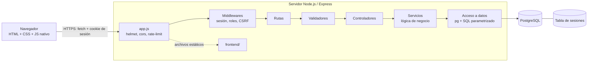
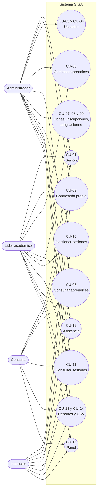
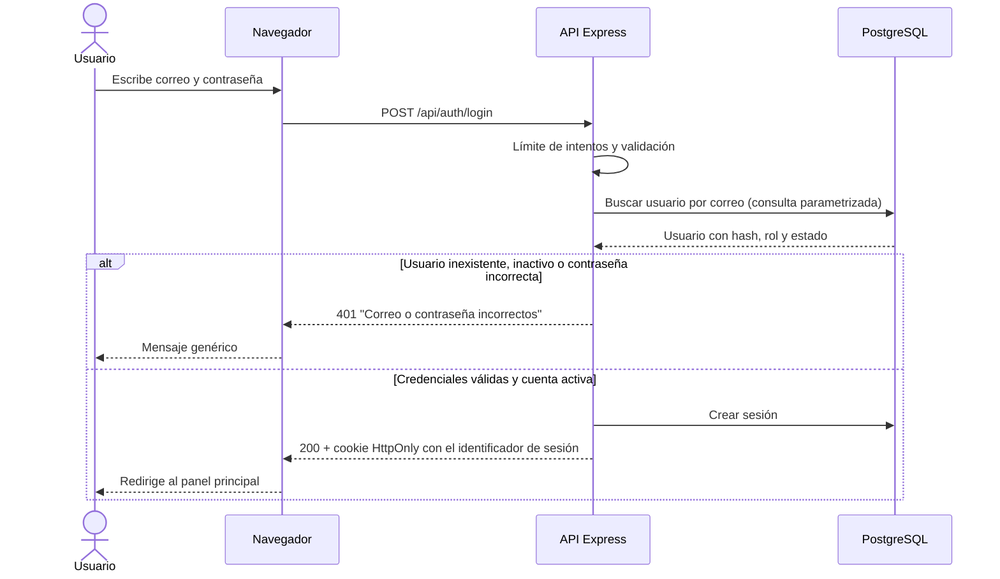
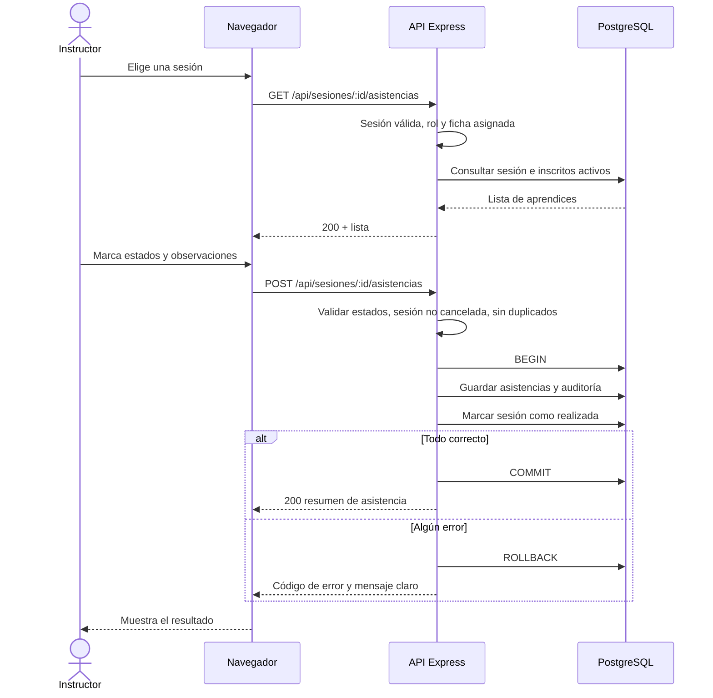
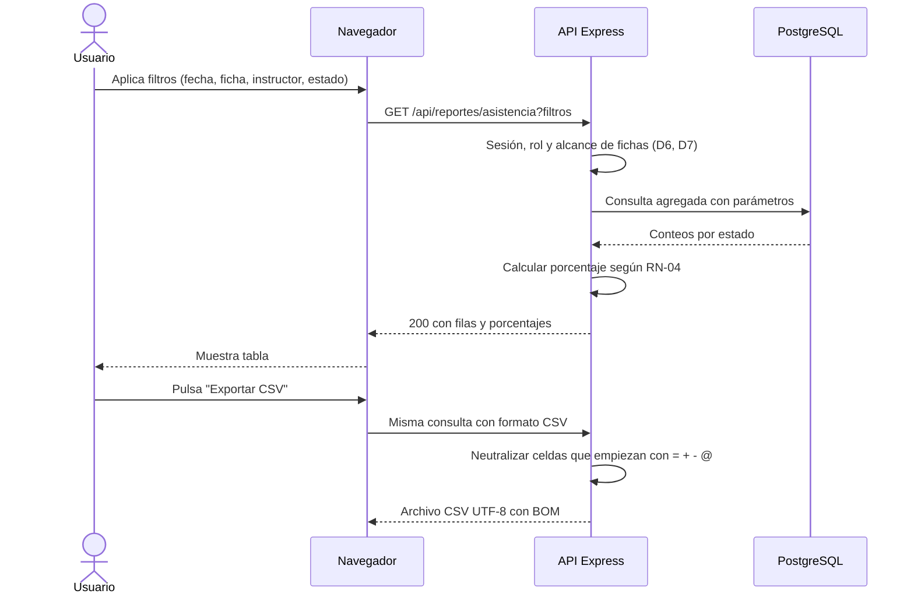

# Arquitectura de SIGA

Proyecto formativo independiente (ADSO). No es una plataforma oficial del SENA.
Las decisiones D1 a D7 y las reglas RN-01 a RN-16 están en `docs/requisitos.md` y
`docs/historias-usuario.md`.

## 1. Visión general

SIGA es una aplicación cliente-servidor. El navegador carga páginas HTML, CSS y
JavaScript nativo que el mismo servidor Express entrega (decisión D1). El
JavaScript del navegador se comunica con una API REST bajo `/api` mediante
`fetch`. La API consulta y modifica PostgreSQL.



## 2. Responsabilidad de cada capa

| Capa | Carpeta | Responsabilidad | Lo que NO debe hacer |
|---|---|---|---|
| Configuración | `backend/src/config/` | Leer variables de entorno y crear la conexión a PostgreSQL | Contener lógica de negocio |
| Rutas | `backend/src/routes/` | Asociar cada URL y método HTTP con su middleware y controlador | Consultar la base de datos |
| Middlewares | `backend/src/middlewares/` | Sesión, verificación de rol, CSRF, manejo de errores | Conocer reglas de un módulo concreto |
| Validadores | `backend/src/validators/` | Verificar y normalizar la entrada, aceptar solo campos permitidos | Escribir en la base de datos |
| Controladores | `backend/src/controllers/` | Leer la petición, llamar al servicio, responder con el código HTTP correcto | Escribir SQL |
| Servicios | `backend/src/services/` | Reglas de negocio, transacciones y consultas SQL parametrizadas | Conocer `req` ni `res` de Express |
| Aplicación | `app.js`, `server.js` | `app.js` arma Express; `server.js` lo arranca | Mezclar ambas tareas |
| Frontend | `frontend/` | Páginas, estilos y scripts que consumen la API | Aplicar permisos como medida de seguridad |

Regla práctica: si cambias una regla de negocio, solo debería cambiar un servicio.

## 3. Ciclo de una solicitud

1. El navegador envía una solicitud a `/api/...` con la cookie de sesión.
2. Express aplica `helmet`, el límite de solicitudes y el análisis del cuerpo JSON.
3. El middleware de sesión identifica al usuario. Sin sesión válida responde 401.
4. El middleware de rol verifica el permiso de la operación. Sin permiso responde 403.
5. Para métodos que modifican datos se verifica la protección CSRF.
6. El validador comprueba los datos. Si son inválidos responde 400 o 422.
7. El controlador llama al servicio, que ejecuta la lógica y las consultas.
8. Si todo sale bien, el controlador responde en JSON. Si algo falla, el manejador
   central de errores responde con un mensaje genérico y registra el detalle en el
   servidor.

### Formato de respuesta (propuesta, se fija en la Etapa 5)

```json
{ "ok": true, "datos": {}, "meta": { "pagina": 1, "total": 0 } }
```

```json
{ "ok": false, "error": { "codigo": "VALIDACION", "mensaje": "Texto para el usuario" } }
```

Códigos HTTP previstos: 200 y 201 (éxito), 400 y 422 (datos inválidos), 401 (sin
sesión), 403 (sin permiso), 404 (no existe), 409 (conflicto, por ejemplo un
documento duplicado), 429 (demasiados intentos) y 500 (error interno).

## 4. Estrategia de autenticación y seguridad web

| Aspecto | Decisión | Motivo |
|---|---|---|
| Sesión | Guardada en PostgreSQL (D2) | Permite revocarla al cerrar sesión o desactivar la cuenta (RN-16) |
| Cookie | `HttpOnly`, `SameSite=Lax`, `Secure` en producción | JavaScript no puede leerla; se reduce el riesgo de XSS y CSRF |
| CSRF (propuesta) | Cabecera personalizada obligatoria en `POST`, `PUT` y `DELETE`, más verificación del encabezado `Origin` | Una página de otro sitio no puede enviar esa cabecera sin permiso de CORS |
| CORS | Restringido al origen de la aplicación | Con D1 casi no hay solicitudes entre orígenes |
| Contraseñas | Argon2id (alternativa: bcrypt) | Nunca se guardan en texto plano |
| Fuerza bruta | Límite de solicitudes en el inicio de sesión | Reduce los intentos masivos |
| XSS | El frontend usa `textContent` para datos del usuario y evita `innerHTML` con ellos | Evita ejecutar código inyectado |
| SQL | Solo consultas parametrizadas | Evita inyección SQL |
| Errores | Mensaje genérico al cliente, detalle en el registro del servidor | No revela información interna |

## 5. Casos de uso

| Id | Caso de uso | Actores | Historias |
|---|---|---|---|
| CU-01 | Iniciar y cerrar sesión | Todos | HU-01, HU-02 |
| CU-02 | Cambiar contraseña propia | Todos | HU-03 |
| CU-03 | Gestionar usuarios | Administrador | HU-04 |
| CU-04 | Restablecer contraseña de un usuario | Administrador | HU-05 |
| CU-05 | Gestionar aprendices | Administrador, Líder | HU-06, HU-08 |
| CU-06 | Consultar aprendices e historial | Administrador, Líder, Instructor, Consulta | HU-07, HU-09 |
| CU-07 | Gestionar fichas | Administrador, Líder | HU-10 |
| CU-08 | Inscribir aprendices en una ficha | Administrador, Líder | HU-11 |
| CU-09 | Asignar instructores a una ficha | Administrador, Líder | HU-12 |
| CU-10 | Programar, editar y cancelar sesiones | Administrador, Líder, Instructor | HU-13, HU-15 |
| CU-11 | Consultar sesiones | Todos | HU-14 |
| CU-12 | Tomar y corregir asistencia | Administrador, Líder, Instructor | HU-16, HU-17 |
| CU-13 | Ver resumen de asistencia de una sesión | Administrador, Líder, Instructor, Consulta | HU-18 |
| CU-14 | Consultar reportes y exportar a CSV | Administrador, Líder, Instructor, Consulta | HU-19, HU-20 |
| CU-15 | Ver el panel principal | Todos | HU-21 |

### Diagrama de casos de uso por actor



Nota: para el Instructor, los casos CU-06, CU-10, CU-11, CU-12 y CU-14 se
limitan a las fichas que tiene asignadas (D6). Para Consulta, solo lectura y sin
datos de contacto (D7).

## 6. Diagramas de secuencia

### 6.1 Inicio de sesión (HU-01)



### 6.2 Tomar asistencia (HU-16)



### 6.3 Reporte de asistencia y exportación a CSV (HU-19, HU-20)



## 7. Despliegue previsto (se verifica en la Etapa 9)

Un solo servicio Node.js que sirve frontend y API, y una base de datos PostgreSQL
administrada. Los planes gratuitos pueden cambiar o suspender la aplicación por
inactividad; las condiciones vigentes se comprueban antes de elegir proveedor.

## 8. Pendientes de esta etapa

- Fijar el formato definitivo de respuestas y errores (Etapa 5).
- Concretar el nombre de la tabla de sesiones y la cabecera CSRF (Etapa 5).
- Modelo entidad-relación final y diccionario de datos (Parte 4).